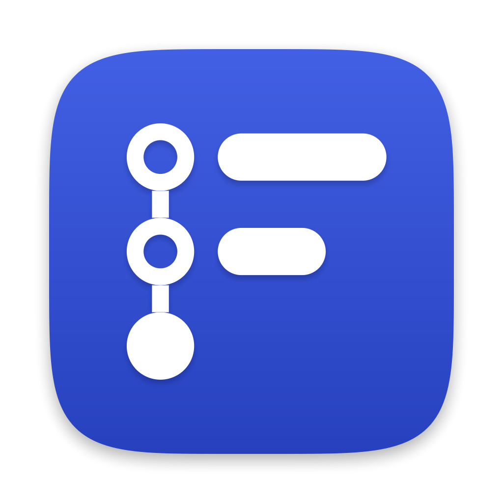
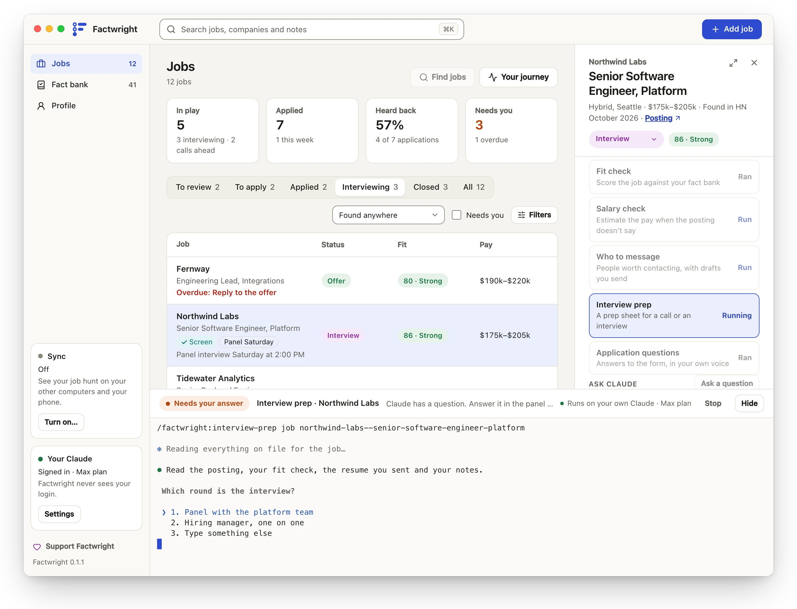
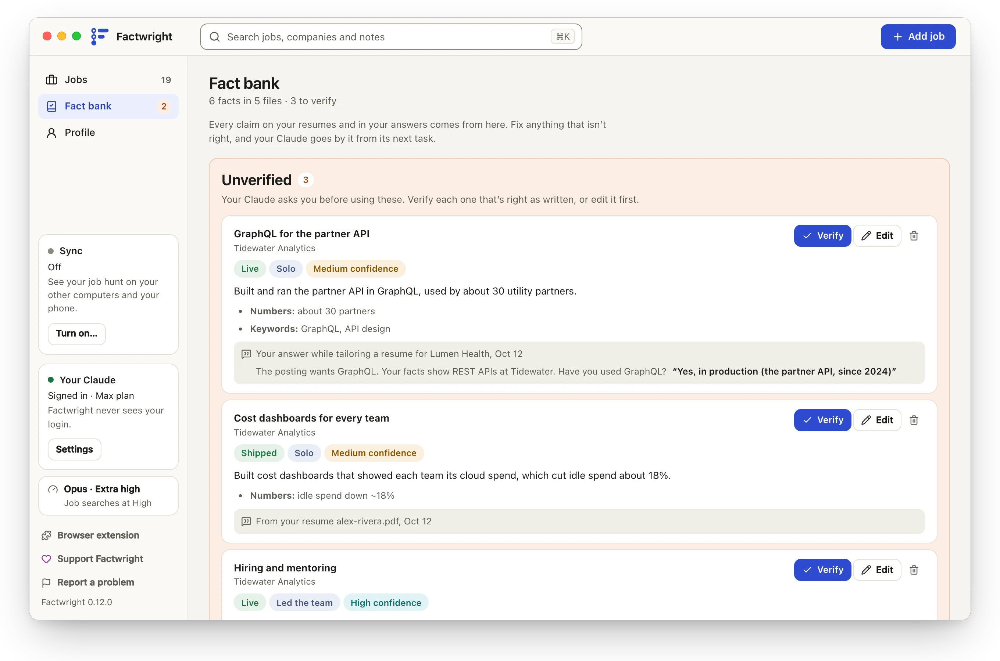
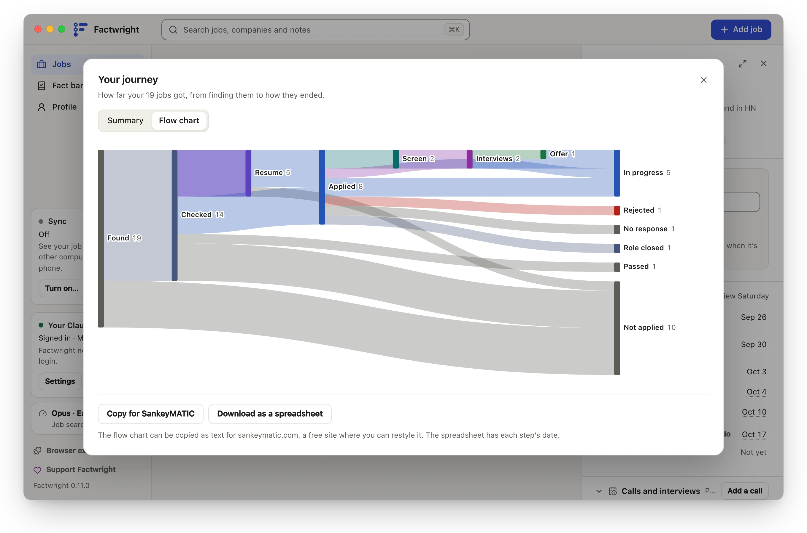

<div align="center">



# Factwright

**Tailored to the job. True to the facts.**

A free, open-source job hunt app for Mac and Windows, run by your own Claude.<br>
Every resume line and application answer traces back to a fact you've confirmed.

[Download for Mac](https://factwright.com/download/mac) · [Download for Windows](https://factwright.com/download/windows) · [Website](https://factwright.com) · [How your data is protected](docs/security.md)

[](CHANGELOG.md)
[](https://github.com/factwright/factwright/actions/workflows/ci.yml)
[](LICENSE)
[](https://factwright.com/download)

</div>

<picture>
  <source media="(prefers-color-scheme: dark)" srcset="docs/images/jobs-dark.webp">
  
</picture>

Factwright is a desktop app that runs your job hunt on top of Claude Code, using your own Claude account. At its center is a **fact bank**: everything you've done, written as claims you can check. Every resume, answer and prep sheet is built from it, so what you send is tailored to the job and still true.

> [!NOTE]
> Factwright is in beta. The [changelog](CHANGELOG.md) says what's new, and the [roadmap](docs/roadmap.md) where it's headed.

## What it does
- **Getting started.** Share your old resumes, your LinkedIn, screenshots and everything you'd say about yourself, then say what you're looking for. Your Claude drafts your fact bank from it, interviews you to confirm it, and builds your first resumes.
- **Fact bank.** Your experience as checkable claims: what you did, how far it got, and how to say it. It grows each time an application asks about something new, and you can read, search and fix every fact in the app.
- **Find jobs.** Searches Hacker News's monthly "Who is hiring?" thread, companies' job boards, a company you have in mind, and LinkedIn's and Indeed's listings, which it finds through web search and reads on the employer's own site. Factwright never signs in to LinkedIn.
- **Fit check.** Scores a job against your fact bank before you spend time on it, along with what people say about the company.
- **Tailored resumes.** A resume for each job, in a template you pick, then a second pass that fact-checks every line. PDF or Word. Bring a resume whose look you like, and your Claude makes a template of your own in that look.
- **Cover letters.** A letter for each job, in your own voice, from your facts and what's on file about the company, addressed to the hiring manager when one is known. It's fact-checked like the resume and built in the same template, so the two look like a set, with its text ready to copy into a form.
- **Projects and life outside work.** Projects in any field, from an app or open source to volunteering or a club you run, with how much to show each, and who you are outside work. Your resumes show projects as you choose: in a section, as experience, or not at all. For a job they help with, a one-page Projects page in the same look goes only where you send it.
- **Answers and interview prep.** Application answers and prep sheets drafted from the same facts, in your voice. Keep what you actually sent beside each question, so it's there when the job moves on.
- **Ask about a job.** Ask anything, such as what to expect from a call, with screenshots if you have them. Claude answers from everything on file for the job and the web, and the answer stays with the job.
- **Calls and interviews.** Each step of a company's process, with who it's with, when, for how long and how to join. Fill one in from the company's calendar invite, add it to your own calendar, and get a reminder an hour before. Call prep writes a sheet for that call that builds on how the earlier rounds went: what to expect, who you're meeting, likely questions answered from your facts, and questions to ask each person. Practice it in a mock interview, note how it went afterward, and get thank-you notes to send.
- **Tracking.** Every job's progress, calls, interviews and dated notes in one place, with your history with each company, on your computer and your phone, and your whole journey drawn as a flow chart.

<table>
  <tr>
    <td width="50%">
      <a href="docs/images/fact-bank-light.webp"><picture>
        <source media="(prefers-color-scheme: dark)" srcset="docs/images/fact-bank-dark.webp">
        
      </picture></a>
    </td>
    <td width="50%">
      <a href="docs/images/journey-light.webp"><picture>
        <source media="(prefers-color-scheme: dark)" srcset="docs/images/journey-dark.webp">
        
      </picture></a>
    </td>
  </tr>
  <tr>
    <td align="center"><b>The fact bank:</b> what's true, and how to say it</td>
    <td align="center"><b>Your journey:</b> how far your jobs got, and how they ended</td>
  </tr>
</table>

## How it's built
- **Your Claude, untouched.** Factwright launches the Claude Code you've already installed and signed in to, in a panel you can watch. It never sees, stores or passes your login, and runs use your own plan or API key.
- **Your files, on your computer.** Claude works on plain files in a folder on your machine, using tools Factwright provides instead of a shell.
- **Your data, encrypted.** Sync is optional. It encrypts your job hunt on your computer before it's uploaded, with a key our servers never see, so they store it only in a form they can't read. The web view on your phone runs code the server sends, which [docs/security.md](docs/security.md) explains.
- **Out in the open.** All of its code is here, under the AGPL-3.0, so you can read what it does, or build the app yourself.

More in [architecture](docs/architecture.md) and [security](docs/security.md).

## Install
- **Mac:** [download Factwright](https://factwright.com/download/mac) for Apple silicon and Intel, on macOS 13 or later.
- **Windows:** [download Factwright](https://factwright.com/download/windows) for 64-bit Windows 10 and 11.
- **Your browser:** Save to Factwright, an extension for Chrome and Firefox, saves the job you're looking at, with its posting, to your job hunt: straight to Factwright on the same computer, with no account, or through sync from another. [Its page](https://factwright.com/extension) says where to get it.
- **Sync, if you want it:** your other computers, your phone and Save to Factwright, end-to-end encrypted. [Factwright's sync](https://factwright.com/sync) is $5 a month or $50 a year. [A sync server of your own](https://factwright.com/own-server) is free.

You also need [Claude Code](https://code.claude.com/docs/en/setup), signed in with a Claude plan or an API key. Factwright checks your setup when it opens, walks you through anything that's missing, and keeps itself up to date.

## Support Factwright
Factwright is free and open source. It's built by [Steve Hillyer](https://github.com/steve1two). If it helps your job hunt, you can support it:

<a href="https://github.com/sponsors/steve1two"></a>
<a href="https://buymeacoffee.com/stevehillyer"></a>

## Repository layout
| Path | What's there |
|---|---|
| [`apps/desktop`](apps/desktop) | The app for Mac and Windows |
| [`apps/web`](apps/web) | The web view of your job hunt, for your phone or any browser |
| [`apps/server`](apps/server) | The sync server |
| [`apps/site`](apps/site) | The website, factwright.com |
| [`apps/extension`](apps/extension) | Save to Factwright, the browser extension for Chrome and Firefox |
| [`packages/core`](packages/core) | Shared logic: reading the workspace, jobs, tracker rules and pay parsing |
| [`packages/sync`](packages/sync) | End-to-end encryption and the sync protocol |
| [`packages/ui`](packages/ui) | The design system and shared screens |
| [`packages/engine`](packages/engine) | Turns resume data into PDF and Word files |
| [`packages/xray`](packages/xray) | The ATS X-ray: reads a resume file the way an applicant tracking system does, and checks it |
| [`plugin`](plugin) | The skills Factwright gives Claude Code, such as the fit check and interview prep |
| [`docs`](docs) | Architecture, security, releasing and the roadmap |

## Development
You need Node.js 24 or newer and pnpm.

```bash
pnpm install
pnpm dev     # run the app
pnpm check   # format, lint, typecheck and test
pnpm fix     # apply formatting and safe lint fixes
```

Each folder's README says how its part works and how to run it. A copy you build doesn't sync or update through Factwright's servers: [`apps/desktop`](apps/desktop#sync) says how to build one that syncs and updates through your own. Releases are built, signed and published by GitHub when a version is tagged: see [docs/releasing.md](docs/releasing.md).

## Contributing
Pull requests aren't open yet, but bug reports and ideas are welcome as issues. See [CONTRIBUTING.md](CONTRIBUTING.md). Please report security problems privately, as [SECURITY.md](SECURITY.md) explains.

## License
[AGPL-3.0](LICENSE). Copyright © 2026 Neatifai LLC.

The resume fonts in [`packages/engine/fonts`](packages/engine/fonts) are under the SIL Open Font License 1.1, by their own authors.

Factwright isn't affiliated with Anthropic. Claude and Claude Code are trademarks of Anthropic, PBC.
