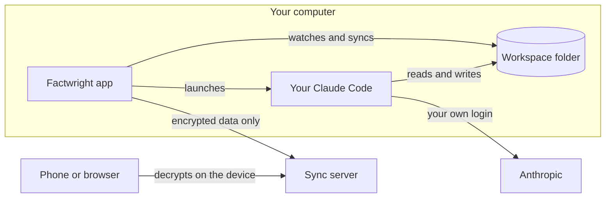

# Architecture

> [!NOTE]
> This is the design. Most of it isn't built yet; the [roadmap](roadmap.md) shows what exists today.

## The desktop app
An Electron app for Mac and Windows ([`apps/desktop`](../apps/desktop)). It holds your dashboard and tracker, runs Claude Code in a built-in terminal, and syncs your data.

## Getting started
A new user's first stop is **Get started**, a few calm steps in the app: who they are, their resumes and LinkedIn (a profile saved as a PDF, or LinkedIn's own data export, since Factwright never signs in to LinkedIn), screenshots, everything they want to say about themselves in their own words, what they're looking for, and which resume templates they like. It's all saved as they go, in the workspace's `about-me/` folder, so they can stop and come back.

The window reads the text out of each PDF and Word file itself, in its sandbox; the app checks every file again (its type, its size, and that its bytes are what its name says) before keeping it. The last step hands everything to the user's Claude with `/factwright:get-started`, which drafts the fact bank with every claim marked `unconfirmed`, interviews the user to confirm it, then builds and fact-checks a starting resume in each template they picked. The **Profile** page follows along, and keeps every answer changeable afterward.

Starting Claude on getting started gets the workspace ready for it first: the app copies in the starter guide ([`plugin/starter`](../plugin/starter)) where files are missing, and writes the files built from the answers: the search criteria, the templates, and the page count. A file someone has changed by hand since the app wrote it is left as it is.

## Your Claude Code
Factwright doesn't have an AI of its own. It launches the Claude Code you installed and signed in to, unmodified, in a real terminal you can watch and type into. It loads Factwright's skills and tools for that session only, through Claude Code's own command-line flags, and never changes your Claude settings.

When you click **Run** on a job, the app starts a session in your workspace and sends the command, such as a fit check or a tailored resume. Claude asks you questions in that terminal when it needs to. Claude Code hooks tell the app when a run finishes or is waiting on you.

## Tools for Claude
Claude doesn't get a shell. Instead, the app gives it a small set of tools over MCP, which it serves itself, on this computer, while a run is live ([`apps/desktop/src/main/tools`](../apps/desktop/src/main/tools)):
- see whether you've seen a job before, and how it went
- look up everything on file for a job, including your notes and calls
- read a web page, and save a job posting word for word
- build a resume as a PDF or Word file, with how it fits the pages

The skills ([`plugin`](../plugin)) tell Claude how to use them for each task, such as a fit check or interview prep.

## The workspace
Claude works on plain files in a folder on your computer:

| Folder | What's in it |
|---|---|
| `about-me/` | What you told Factwright: your answers, your own words about yourself, and the files you shared |
| `facts/` | The fact bank: your experience as checkable claims |
| `guide/` | Your rules, preferences and resume templates, and how to write and tailor a resume |
| `base/` | Your starting resumes, one for each kind of company you're aiming at, and a folder of them for each other kind of job you want |
| `applications/` | One folder per job: posting, fit check, notes, answers, prep and resumes |
| `searches/` | Job searches, your search criteria, and logs of fit, salary and employer checks |
| `outreach/` | Messages drafted for people at a company |
| `asked/` | Claude's answers to your own questions about a job, one folder per job |
| `screenshots/` | Screenshots you added for a job, or pasted into Claude's panel, one folder per job |
| `linkedin/` | The spreadsheets from your LinkedIn data export, such as your connections |

The app watches this folder, and reads it again whenever something changes. What you track by hand, such as statuses, dates, calls, notes, the answers you sent and your questions for Claude, lives in a small database beside the workspace, where Claude's file tools can't reach it.

Before Claude works on a job, `job_details` hands it a catalog of everything on file for that job, a line for each file saying what it holds, with what you've tracked about it. Claude reads what bears on the task rather than all of it, and `about_you` and `past_answers` do the same for you: what you told Factwright, and what you sent on applications.

## Sync and storage
Once you turn sync on, your other computers and your phone see the same job hunt. Each device locks everything before it leaves, so the server stores only data it can't read. The design is in [security.md](security.md).

- **The sync server** ([`apps/server`](../apps/server)) runs on Cloudflare. Each account gets its own store, a Durable Object with its own database, plus a private folder of encrypted files in R2. The server works out who you are from your verified session only, and no request can name another account.
- **The desktop app** syncs the workspace's files and the tracker's rows a moment after each change, and right away when another device changes something. When two devices change the same thing, nothing is lost: a file keeps both copies, and a tracked job merges.
- **History:** each record keeps its earlier versions for 90 days, each file's contents are stored once, and every store is backed up daily.
- **The web view** ([`apps/web`](../apps/web)) downloads your locked data and opens it in the browser, with keys kept there. It builds the job list with the same code as the desktop app.
- **The browser extension** ([`apps/extension`](../apps/extension)), Save to Factwright, adds jobs through sync: it signs in with a device code, links like a browser, and pushes a job's rows and its posting, locked with the account's keys, as Add job would. The posting lands in `saved/<job ID>/posting.md`, apart from the job's folder, and `save_posting` copies it there when Claude starts work on the job.

## Resumes
Resume data is JSON. The engine ([`packages/engine`](../packages/engine)) renders it to PDF with the browser built into Electron, and to Word with the `docx` library, in a template: one of the two the app comes with, Classic and Minimal, or one of the user's own. Changing the look never changes the words.

A template is data, kept as a JSON file: its styles, markup in Mustache's syntax that the engine fills in from the resume, the fonts it carries, what it calls each section, and its look in Word. The user's own live in the workspace's `templates/` folder, so they sync with everything else. They come from a file someone shared, or from Claude, which makes one in the look of a resume the user likes (`/factwright:make-template`), from a PDF or a picture of it. A template can come from anywhere, so the engine checks each one before it's used: only elements and attributes for text, every value escaped, styles that load nothing, and no words of its own, so every word on a resume comes from the resume or the template's section titles. The page runs no scripts, and resumes print in a hidden, sandboxed window that loads nothing but the page itself.

The ATS X-ray ([`packages/xray`](../packages/xray)) reads a resume back the way an applicant tracking system does: a PDF with pdf.js, in the order the file draws its text, and a Word file from its XML. It finds what a parser fills in and what would trip one up, and checks the job posting's terms against the resume and the fact bank, so it only ever suggests a term the user can back. It all runs in the window, from the file itself, with no Claude.

A job's resume can go from its X-ray to Claude for revision. The window turns the X-ray into findings, each with an ID that stays the same from one X-ray to the next and holds none of the posting's words, such as `check-dates` or `term-3c5e0f21`, and the user picks which to send. The main process checks what the window sends and that the job's resume data builds the file, keeps the resume's previous version in the job's `previous/` folder, and holds the findings for the run it starts next, which gets only their IDs and can't reach the web. Once that run starts, it writes what was picked beside the previous version. The run reads the findings through `revision_findings`, which answers only that run, then fixes the resume with the tools any tailored resume uses. Opened again, the X-ray compares its findings with the ones picked before: fixed, settled as something the user doesn't have, still there, or not checked this time.

## The website
factwright.com ([`apps/site`](../apps/site)) is a static page built from the same design system as the app, served by a small Worker of its own on Cloudflare. It sits on its own address, apart from the web view and sync server at app.factwright.com, so nothing on it shares the address where the web view keeps its keys.
