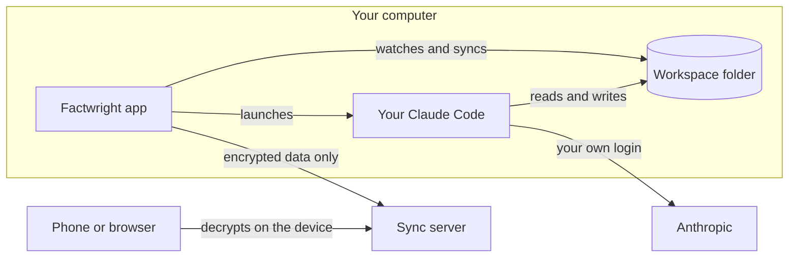

# Architecture

> [!NOTE]
> This is the design. Most of it isn't built yet; the [roadmap](roadmap.md) shows what exists today.

## The desktop app
An Electron app for Mac and Windows ([`apps/desktop`](../apps/desktop)). It holds your dashboard and tracker, runs Claude Code in a built-in terminal, and syncs your data.

## Your Claude Code
Factwright doesn't have an AI of its own. It launches the Claude Code you installed and signed in to, unmodified, in a real terminal you can watch and type into. It loads Factwright's skills and tools for that session only, through Claude Code's own command-line flags, and never changes your Claude settings.

When you click **Run** on a job, the app starts a session in your workspace and sends the command, such as a fit check or a tailored resume. Claude asks you questions in that terminal when it needs to. Claude Code hooks tell the app when a run finishes or is waiting on you.

## Tools for Claude
Claude doesn't get a shell. Instead, the app gives it a small set of tools over MCP, which it serves itself, on this computer, while a run is live ([`apps/desktop/src/main/tools`](../apps/desktop/src/main/tools)):
- see whether you've seen a job before, and how it went
- look up everything on file for a job, including your notes and calls
- read a web page, and save a job posting word for word
- build a resume as a PDF or Word file, with how it fits the pages

The skills ([`plugin`](../plugin)) tell Claude how to use them for each task, such as a fit check or interview prep.

## The workspace
Claude works on plain files in a folder on your computer:

| Folder | What's in it |
|---|---|
| `facts/` | The fact bank: your experience as checkable claims |
| `guide/` | Your rules and preferences for resumes and answers |
| `applications/` | One folder per job: posting, fit check, notes, answers, prep and resumes |
| `searches/` | Job searches, your search criteria, and logs of fit, salary and employer checks |
| `outreach/` | Messages drafted for people at a company |

The app watches this folder, and reads it again whenever something changes. What you track by hand, such as statuses, dates, calls and notes, lives in a small database beside the workspace, where Claude's file tools can't reach it.

## Sync and storage
Once you turn sync on, your other computers and your phone see the same job hunt. Each device locks everything before it leaves, so the server stores only data it can't read. The design is in [security.md](security.md).

- **The sync server** ([`apps/server`](../apps/server)) runs on Cloudflare. Each account gets its own store, a Durable Object with its own database, plus a private folder of encrypted files in R2. The server works out who you are from your verified session only, and no request can name another account.
- **The desktop app** syncs the workspace's files and the tracker's rows a moment after each change, and right away when another device changes something. When two devices change the same thing, nothing is lost: a file keeps both copies, and a tracked job merges.
- **History:** each record keeps its earlier versions for 90 days, each file's contents are stored once, and every store is backed up daily.
- **The web view** ([`apps/web`](../apps/web)) downloads your locked data and opens it in the browser, with keys kept there. It builds the job list with the same code as the desktop app.

## Resumes
Resume data is JSON. The engine ([`packages/engine`](../packages/engine)) renders it to PDF with the browser built into Electron, and to Word with the `docx` library.
